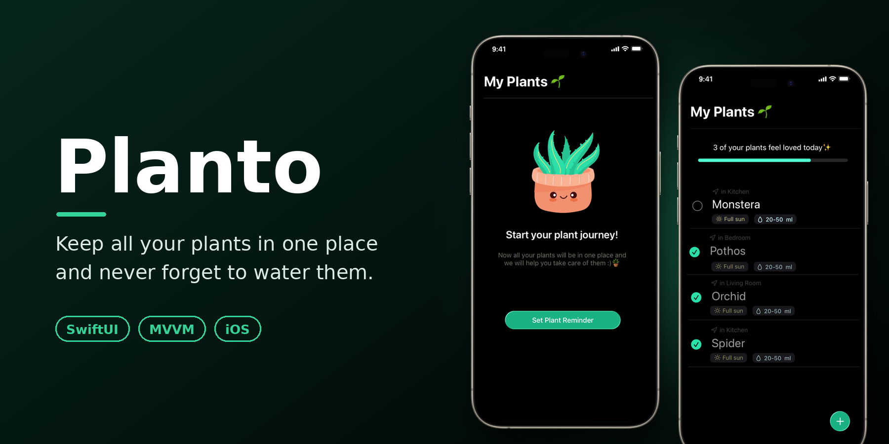

# 🌱 Plant Care

A simple iOS application designed to help
users take care of their plants and keep
track of their plant care routine.

## App Purpose

Plant Care is an iOS application that helps
users organize and manage their plants.

It provides an easy way to keep plant
information, track plant care activities,
and make plant care more organized.

## Main Features

- **Onboarding:** Introduces users to the app.
- **Add a Plant:** Allows users to add new plants.
- **Plant Details:** Displays plant information.
- **Care Reminders:** Reminds users about plant care.
- **Plant Tracking:** Helps users track plant care.
- **Edit Plant:** Allows users to update plant details.
- **Delete Plant:** Allows users to remove plants.

## Technologies Used

- Swift
- SwiftUI
- Xcode
- GitHub

# 🌱 Plant Care

